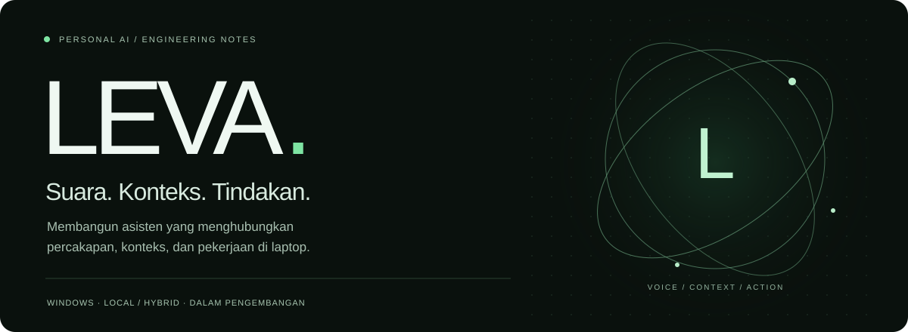
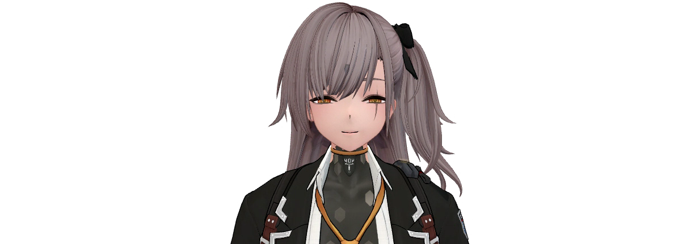
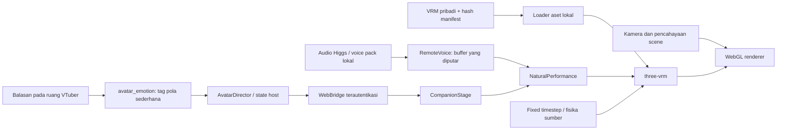

<p align="center"></p>

<p align="center"><a href="#tentang-leva"><b>Tentang</b></a> · <a href="#ruang-kerja"><b>Ruang kerja</b></a> · <a href="#avatar-3d--r1"><b>Avatar 3D</b></a> · <a href="#alur-modul-avatar"><b>Arsitektur</b></a> · <a href="#menjalankan-source"><b>Source & validasi</b></a></p>

# Leva — Personal AI Assistant

Asisten AI pribadi untuk Windows yang menghubungkan percakapan, suara modular, konteks, dan alat pekerjaan pada laptop. Desktop dan web memakai layanan pelaksana yang sama; HP menjadi antarmuka bagi laptop.

> **Snapshot source: 0.40.0, 25 Oktober 2026.** Repository kini berisi source runtime pengembangan yang diperbarui dari import historis 0.3.0. R1 adalah kandidat peningkatan animasi/ekspresi avatar 3D, belum avatar premium final. Model AI, model karakter, voice pack, API key dan data pengguna tidak disertakan.

## Tentang Leva

<table><tr><td width="33%" valign="top"><h3>Percakapan</h3><p>Ruang dengan tujuan berbeda, konteks per ruang, dan pemilihan model sesuai kebutuhan. ASR, LLM dan TTS merupakan tahap terpisah.</p></td><td width="33%" valign="top"><h3>Pekerjaan</h3><p>Alat laptop, terminal, berkas, progres dan jurnal tugas. Keberhasilan perlu diperiksa dari hasil alat; kendali universal semua aplikasi belum dijamin.</p></td><td width="33%" valign="top"><h3>Karakter</h3><p>Avatar Leva 3D dengan controller ekspresi dan gerak, suara modular, serta UI web yang dapat dipakai dari perangkat pribadi.</p></td></tr></table>

## Ruang kerja

| Ruang | Arah penggunaan | Batas |
|---|---|---|
| Asisten | Tugas dengan alat yang tersedia | Bukan jaminan dapat mengontrol setiap aplikasi/canvas/game |
| Chat | Percakapan dan analisis kiriman | Jalur percakapan dibedakan dari eksekusi alat |
| Secret ♡ | Percakapan personal | Nama ruang bukan enkripsi; akses perangkat mengikuti konfigurasi pengguna |
| Leva ♡ 3D | Preview companion dan animasi avatar | Masih pengembangan; membutuhkan aset pribadi yang penggunaannya sesuai |

## Avatar 3D — R1

**3D dikerjakan lebih dahulu. Versi 2D ditunda sampai kualitas 3D dinilai cukup oleh pemilik proyek.** Placeholder lama tidak dipresentasikan sebagai versi 2D final.



[Lihat rekaman transisi wajah tanpa audio](docs/avatar/r1/media/r1-facial-transitions.mp4) · [Laporan visual](docs/avatar/r1/LEVA_PREMIUM_VISUAL_COMPARISON.md) · [Hasil QA](docs/avatar/r1/LEVA_AVATAR_PERFORMANCE_QA.md)

Yang sudah dikerjakan pada R1:

- Gerak kepala, napas, torso dan gaze yang kecil serta mengikuti state.
- Blending ekspresi, cooldown, interval blink bervariasi dan penanganan morph yang tidak tersedia.
- Mulut berdasarkan audio yang benar-benar diputar, dengan noise gate dan attack/release smoothing. Ini belum lip-sync phoneme yang akurat.
- Tag ekspresi konservatif dari balasan; kalibrasi prosedural, bukan neural-network training.
- Scene lights Premium Studio, Soft Anime, Night dan Dark Environment. Material model sumber tetap dipertahankan.
- Inspector developer: baseline/R1, physics on/off/reset, pose freeze, slow motion, bobot ekspresi dan telemetri renderer.
- Buffer timing terbatas dan empat profil render/fisika yang mengubah runtime.

**Belum selesai:** shader/tekstur/mesh baru pada sumber, collider rambut/pita/pakaian tambahan, sertifikasi bebas clipping, articulation phoneme, binding renderer ke RTX4050, pengujian jangka panjang dan penerimaan visual pengguna. Snapshot ini tidak menyamakan kontrol scene dengan modifikasi aset premium.

| Bukti pengembangan di Windows | Hasil |
|---|---|
| Regresi aplikasi | 610 tes dijalankan; satu skip khusus engine gambar |
| Skrip JavaScript | 12 skrip lulus; termasuk 15 behavior checks controller baru |
| Pemeriksaan paket kandidat lokal | 102 lulus |
| Renderer yang teramati | RTX5070; request RTX4050 belum cocok |
| Sampel frame p95 | Premium 16,8 ms; Balanced 33,4 ms; Gaming 33,5 ms; Eco 66,8 ms |

Angka frame berasal dari window pendek tanpa LLM, dengan profil UV pengguna dipertahankan. Bukan sertifikasi performa normal, stress test atau bukti Android fisik. [Ringkasan terstruktur](docs/avatar/r1/verification-summary.json).

## Alur modul avatar



Diagram ini memetakan komponen R1 pada snapshot sekarang. Peta Graphify seluruh proyek di [docs/architecture](docs/architecture) tetap merupakan arsip arsitektur 0.28.0 dan belum dihitung sebagai graph penuh 0.40.0.

## Menjalankan source

Source menargetkan Windows dan menggunakan runtime/model yang dikonfigurasi terpisah. Sesuaikan `app/paths.py` (DATA), registry model dan adapter lokal sebelum menjalankan aplikasi normal. Folder data, credential, VRM dan model tidak dibuat ulang dari repository ini.

```powershell
python -m pip install -r requirements-preview.txt
python experiments/run_isolated_regressions.py ./local-data/verification
node experiments/test_avatar_performance.mjs
```

Salinan source yang diekspor ini juga telah diuji: 610 tes aplikasi (satu skip engine gambar) dan 12 skrip JavaScript berhasil pada 25 Oktober 2026. Regresi mengalihkan DATA ke folder sementara sebelum import aplikasi. Model STT/TTS/LLM dan engine gambar mempunyai environment/dependensi tambahan; file requirements dasar tidak memasang seluruh engine tersebut. Untuk aplikasi yang telah dikonfigurasi lokal, entrypoint adalah `python app/main.py`. Tinjau pengaturan audio/startup yang sesuai untuk perangkat Anda.

`SOURCE_SNAPSHOT.json` mencatat file source yang diekspor dan batasnya. Endpoint tailnet pribadi diganti contoh pada ekspor; tidak menyertakan history, key, database, voice pack, rekaman suara atau arsip mod.

## Dokumentasi pengembangan

- [Struktur model](docs/avatar/r1/LEVA_MODEL_STRUCTURE_AUDIT.md)
- [Scene lights dan batas material](docs/avatar/r1/LEVA_PREMIUM_SHADER_MATERIAL_REPORT.md)
- [Kalibrasi ekspresi](docs/avatar/r1/LEVA_FACIAL_EXPRESSION_CALIBRATION.md)
- [Suara dan animasi](docs/avatar/r1/LEVA_LIPSYNC_ANIMATION_REPORT.md)
- [Rambut/pita/collision yang masih terbuka](docs/avatar/r1/LEVA_HAIR_RIBBON_PHYSICS_REPORT.md)
- [Penilaian pengguna dan rencana versi](docs/avatar/r1/LEVA_PREMIUM_AVATAR_USER_REVIEW.md)

Leva adalah karakter dari Girls' Frontline 2; hak karakter/model milik pencipta dan pemegang hak terkait, termasuk MICA Team. Ini proyek asisten pribadi independen. Model karakter tidak didistribusikan di repo, dan script/renderer tidak memindahkan kepemilikan aset. Lisensi third-party renderer tercatat pada `app/leva_web/THIRD_PARTY_NOTICES.txt`.
