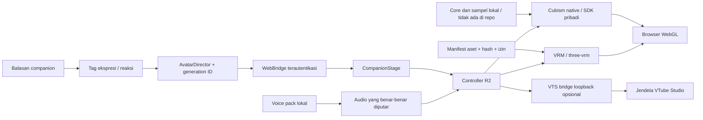

<p align="center"></p>

<p align="center"><b>Desktop · Web · Android interface · Modular voice · Agent tools · Avatar laboratory</b></p>

# Leva — Personal AI Assistant

Asisten AI pribadi untuk Windows yang menghubungkan percakapan, suara, pengetahuan dan alat pekerjaan pada laptop. Desktop dan web memakai layanan pelaksana yang sama; HP menjadi antarmuka pribadi bagi laptop.

> **Source snapshot 0.41.0 · 25 Oktober 2026.** Kandidat pengembangan R2 dan Live2D R0. Model AI, aset karakter, SDK Live2D, voice pack, credential dan data pengguna tidak disertakan. Avatar premium final dan kendali universal seluruh aplikasi belum diklaim selesai.

<table><tr><td width="33%" valign="top"><h3>Percakapan</h3><p>Ruang Asisten, Chat, Secret ♡ dan Leva ♡ dengan konteks serta model sesuai tujuan. ASR, LLM dan TTS merupakan tahap terpisah.</p></td><td width="33%" valign="top"><h3>Pekerjaan</h3><p>Alat aplikasi/browser, terminal, patch, pencarian berkas, progres dan jurnal tugas. Hasil alat perlu diverifikasi; cakupannya tidak menjamin semua canvas atau game.</p></td><td width="33%" valign="top"><h3>Karakter</h3><p>Renderer VRM, controller reaksi/ekspresi, serta backend Live2D native dan VTube Studio opsional. Pemisahan renderer, state dan suara menjaga fleksibilitas.</p></td></tr></table>

## Perkembangan terbaru — R2 dan Live2D R0

- **120 FPS target** dengan frekuensi solver terpisah; Ultra memakai 60 Hz physics secara default. Fallback adaptif 120→60 tersedia, dengan uji overload sintetis.
- **24 profil ekspresi, sembilan reaksi** dan blending kanal yang tersedia. Angka itu bukan jumlah morph baru yang dibuat.
- **Fisika reversibel** pada aset yang boleh dimodifikasi: kategori rambut/pita/pakaian, collider mengikuti tulang, reset saat stall dan pose berubah besar.
- **Audio aktual menggerakkan mulut**, dengan silence/interrupt gate dan variasi berbasis fitur audio; belum phoneme alignment.
- **Live2D native nyata** memakai SDK lokal pengguna: model3, moc3, texture, physics dan pose. Bukti saat ini menggunakan Hiyori resmi, bukan karakter Leva.
- **Bridge VTube Studio** sudah diuji autentikasi dan streaming lokal. Backend eksternal menampilkan model di jendela VTS; tidak menyajikan video avatar ke HP. API dimatikan kembali setelah uji.

3D tetap jalur utama, sementara 2D R0 kini aktif. Ilustrasi konsep Leva belum menjadi artwork berlapis atau rig Cubism. AAA dan model contoh tidak diganti namanya menjadi Leva.

| Validasi kandidat lokal | Hasil |
|---|---|
| Regresi pada source yang disanitasi | **620 tes**, 0 kegagalan, 1 skip engine gambar |
| Skrip JavaScript | **16 lulus** |
| Pemeriksaan frozen package lokal | **104 lulus** |
| Leva VRM Ultra | Sekitar 120 FPS rata-rata window pendek; p95 sekitar 11,2 ms |
| Native Live2D Ultra | 118,35 FPS rata-rata; p95 11,4 ms; solver 60 Hz |
| Native lip-sync | Bukaan mulut 0,585 ketika bicara dan 0 setelah dihentikan |
| GPU renderer yang terbukti | RTX 5070; permintaan RTX 4050 belum cocok |

120 FPS belum terkunci: p95 tersebut melebihi interval 8,33 ms. Window pendek, profil UV dan aplikasi latar pengguna dipertahankan; hasil ini bukan benchmark terkontrol lintas perangkat. Uji Android fisik dan gaming serentak belum selesai. [Ringkasan terstruktur](docs/avatar/r2/verification-summary.json) · [Performa dan batas](docs/avatar/r2/PERFORMANCE.md).

## Arsitektur avatar



State dan audio dibagi; renderer serta asetnya tetap terpisah. Preferensi GPU adalah permintaan yang diverifikasi lewat renderer aktual. Peta Graphify seluruh proyek di [docs/architecture](docs/architecture) masih arsip 0.28.0; diagram di atas adalah peta modul avatar snapshot 0.41.0.

## Bukti visual historis


[Rekaman transisi R1 tanpa audio](docs/avatar/r1/media/r1-facial-transitions.mp4). Media ini berlabel historis 0.40.0; rekaman R2, sampel SDK, suara dan screenshot pribadi disimpan lokal.

## Menjalankan source

Source menargetkan Windows. Sesuaikan lokasi DATA, registry model dan adapter yang dipakai. Repository tidak menyediakan model, folder percakapan, token, SDK Core atau karakter.

```powershell
python -m pip install -r requirements-preview.txt
python experiments/run_isolated_regressions.py ./local-data/verification
node experiments/test_avatar_reactions.mjs
node experiments/test_avatar_timing.mjs
node experiments/test_live2d_native.mjs
```

Pengujian mengalihkan DATA sebelum import aplikasi. STT/TTS/LLM mempunyai environment tambahan. Untuk konfigurasi lokal yang lengkap, entrypoint `python app/main.py`; tinjau pilihan audio/startup terlebih dahulu. Cubism diunduh pengguna secara terpisah dari [Live2D](https://www.live2d.com/en/sdk/download/web/). Script persiapan lokal tidak membundel vendor Core ke GitHub.

## Dokumentasi

- [Laporan kandidat R2 + Live2D R0](docs/avatar/r2/LEVA_PREMIUM_AVATAR_R2_REPORT.md)
- [Fisika dan batas aset](docs/avatar/r2/PHYSICS.md)
- [Reaksi, ekspresi dan audio](docs/avatar/r2/REACTIONS_AUDIO.md)
- [Grafik, supersampling dan status ray tracing](docs/avatar/r2/GRAPHICS.md)
- [Native Live2D dan bridge VTS](docs/avatar/r2/LIVE2D_R0.md)
- [Matriks penerimaan](docs/avatar/r2/ACCEPTANCE.csv)
- [Source snapshot dan pengecualian](SOURCE_SNAPSHOT.json)

**Masih terbuka:** Leva 2D dengan layered art/cmo3/moc3, modifikasi rig/material/tekstur Leva yang diperbolehkan, penilaian clipping menyeluruh, ray tracing, phoneme alignment, pembagian GPU yang terbukti, Android fisik, stress test dan persetujuan visual pemilik proyek. Source VRM Leva yang membatasi modifikasi tetap dipertahankan; keberhasilan pada sampel berizin tidak menggantikan hasil karakter final.

Leva merupakan karakter Girls' Frontline 2; hak karakter dan aset tetap pada pencipta/pemegang hak terkait. Ini proyek asisten pribadi independen. Model asli dan kontribusi script/renderer adalah hal berbeda. Lisensi renderer yang dibundel ada di `app/leva_web/THIRD_PARTY_NOTICES.txt`; SDK dan sampel terpisah mengikuti lisensinya masing-masing.
