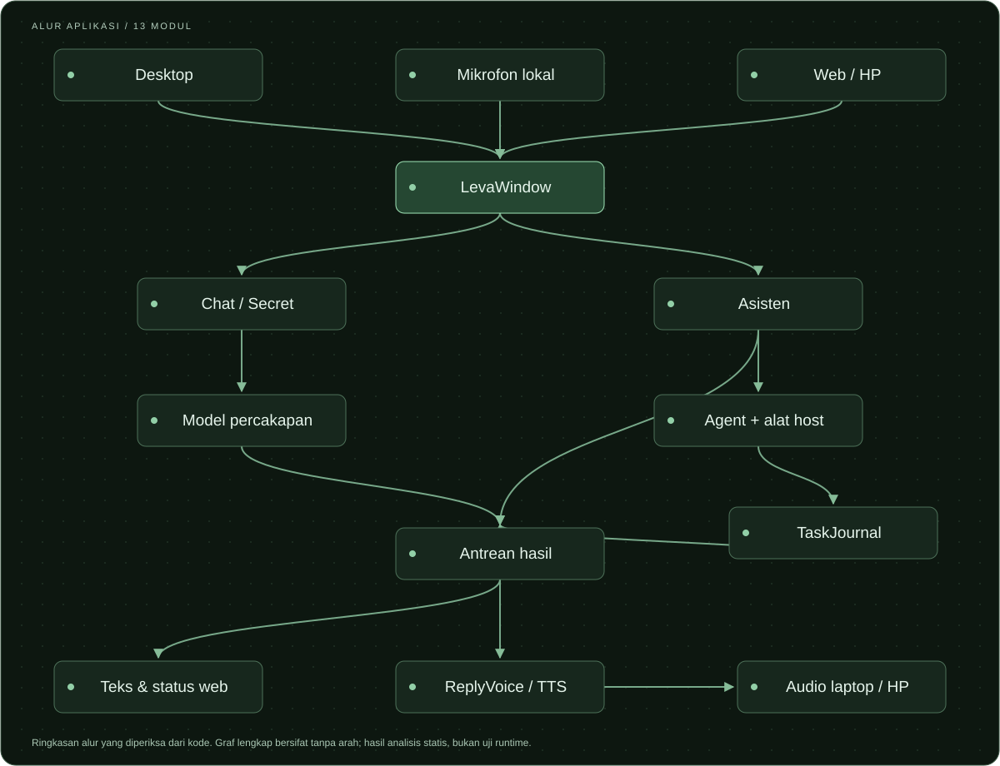
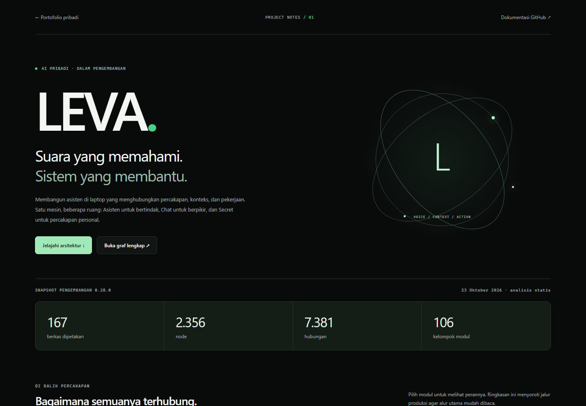

<p align="center">
  
</p>

<p align="center">
  <a href="#tentang-leva"><b>Tentang</b></a> ·
  <a href="#tiga-ruang-satu-asisten"><b>Ruang percakapan</b></a> ·
  <a href="#peta-modul"><b>Arsitektur</b></a> ·
  <a href="#jelajahi-proyek"><b>Dokumentasi</b></a> ·
  <a href="#menjalankan-source-repository"><b>Mulai</b></a>
</p>

# Leva — Personal AI Assistant

Membangun asisten di laptop yang menghubungkan **percakapan, konteks, dan pekerjaan**. Leva dikembangkan untuk mendengar, merespons, memakai alat yang tersedia, dan membantu pekerjaan melalui antarmuka desktop maupun HP.

> **Status proyek:** dalam pengembangan. Peta arsitektur mendokumentasikan snapshot **0.28.0** pada **23 Oktober 2026**. Source yang tersedia di repository ini masih import historis **0.3.0**. Tampilan, diagram, dan kemampuan pengembangan di bawah tidak berarti seluruhnya tersedia setelah menjalankan source 0.3.0.

## Tentang Leva

<table>
  <tr>
    <td width="33%" valign="top">
      <h3>01 / Percakapan</h3>
      <p>Beberapa ruang dengan tujuan berbeda, riwayat per ruang, serta pilihan model untuk kebutuhan percakapan dan analisis.</p>
    </td>
    <td width="33%" valign="top">
      <h3>02 / Pekerjaan</h3>
      <p>Agent, alat pada laptop, progres, dan jurnal tugas yang menghubungkan tujuan pengguna dengan tindakan serta hasilnya.</p>
    </td>
    <td width="33%" valign="top">
      <h3>03 / Suara &amp; HP</h3>
      <p>Pengenalan suara, teks, terjemahan, dan sintesis sebagai tahap terpisah. HP menjadi antarmuka bagi mesin pelaksana di laptop.</p>
    </td>
  </tr>
</table>

Desain ini dipetakan dari kode pengembangan **0.28.0**. Keberhasilan setiap pekerjaan tetap perlu dibuktikan lewat pengujian langsung, termasuk respons suara, pembagian GPU, dan kendali aplikasi.

## Tiga ruang, satu asisten

| Ruang        | Untuk apa?                                                | Jalur yang dipetakan                                                                                            |
| :----------- | :-------------------------------------------------------- | :-------------------------------------------------------------------------------------------------------------- |
| **Asisten**  | Menjalankan pekerjaan pada laptop                         | Perintah desktop atau delegasi ke agent dan alat host; hasil tindakan dicatat untuk pemeriksaan dan kelanjutan. |
| **Chat**     | Analisis, pertanyaan, informasi, dan percakapan fleksibel | Riwayat per ruang, pemilihan model, serta riset publik melalui jalur terbatas; tanpa executor kendali PC.       |
| **Secret ♡** | Percakapan personal dengan respons yang diupayakan cepat  | Jalur percakapan tersendiri. Perpindahan ke Chat/Asisten menawarkan penyalinan riwayat setelah pengguna setuju. |

Riwayat yang tersimpan dan konteks aktif model memiliki batas berbeda. Menyalin riwayat tidak berarti seluruh isinya selalu dimasukkan sekaligus ke dalam konteks model.

## Peta modul

<p align="center">
  
</p>

Desktop, transkrip mikrofon, dan permintaan HP bertemu pada **`LevaWindow`**. Pesan kemudian diarahkan ke ruang percakapan atau jalur Asisten; hasilnya kembali sebagai teks, status pekerjaan, dan audio.

[](docs/architecture/README.md)

<p align="center">
  <a href="docs/architecture/README.md"><b>Baca arsitektur →</b></a> ·
  <a href="docs/architecture/graphify-out/LEVAWINDOW_FLOW.md"><b>Telusuri LevaWindow →</b></a> ·
  <a href="docs/architecture/graphify-out/graph.html"><b>Unduh graf interaktif →</b></a>
</p>

Diagram di atas merupakan ringkasan terkurasi dari pemeriksaan kode. **Graf lengkap bersifat tanpa arah** dan juga mencakup simbol, dokumen, serta pengujian; jalur terpendeknya bukan urutan eksekusi aplikasi. Untuk graf interaktif, unduh `graph.html` dan buka melalui browser. Pustaka visualisasinya dimuat dari CDN dan memerlukan internet.

## Antarmuka & catatan pengembangan

Pratinjau berikut berasal dari **halaman proyek pada portofolio**, yang memperkenalkan Leva dan menyediakan penjelajah modul. Ini dokumentasi proyek, bukan screenshot aplikasi desktop Leva.

[](https://github.com/Diska404/Projek_Portofolio/tree/main/apps/web/src/app/projects/leva)

Portofolio menyertakan pilihan modul melalui tombol, uraian peran, rujukan sumber, dan tautan graf lengkap. Implementasinya tersedia pada [repository portofolio](https://github.com/Diska404/Projek_Portofolio). README ini menyajikan ringkasan visual yang dapat dibaca langsung di GitHub.

## Jelajahi proyek

| Dokumen                                                                     | Isi                                                                                                 |
| :-------------------------------------------------------------------------- | :-------------------------------------------------------------------------------------------------- |
| [Arsitektur Leva](docs/architecture/README.md)                              | Alur utama, diagram Mermaid, cakupan, dan batas bukti.                                              |
| [Penelusuran LevaWindow](docs/architecture/graphify-out/LEVAWINDOW_FLOW.md) | Hubungan desktop, Chat/Secret, suara, HP, dan agent beserta lokasi sumber.                          |
| [Laporan Graphify](docs/architecture/graphify-out/GRAPH_REPORT.md)          | Kelompok modul, komponen penghubung, hubungan inferensi, dan pertanyaan lanjutan.                   |
| [Graf JSON](docs/architecture/graphify-out/graph.json)                      | 2.356 node dan 7.381 hubungan untuk penelusuran lanjutan.                                           |
| [Audit integritas](docs/architecture/graphify-out/graph-health.json)        | Referensi ekstraksi yang belum terselesaikan, self-loop, dan penggabungan hubungan.                 |
| [Provenance & checksum](docs/architecture/graphify-out/SNAPSHOT.json)       | Asal snapshot, versi, cakupan, serta hash berkas publik.                                            |
| [Panduan source 0.3.0](docs/SOURCE_SNAPSHOT_0_3.md)                         | Instalasi, konfigurasi, Neural Voice, pengujian, dan build untuk source historis di repository ini. |

## Menjalankan source repository

**Panduan ini menjalankan source 0.3.0**, dengan Windows 10/11, Python 3.12, dan Tkinter. Jalankan dari root repository:

```powershell
python -m venv .venv
.\.venv\Scripts\python.exe -m pip install -r requirements.txt
.\.venv\Scripts\python.exe -B app\main.py
```

Source historis menyediakan chat Google dengan fallback lokal yang didukung, perintah Chrome/profil, pengaturan, kebiasaan, jeda, serta Neural Voice Google Live. Saat sesi Google Live aktif, audio mikrofon dikirim ke Google. Pilihan runtime/model dan keterbatasan versi tersebut dijelaskan pada [panduan source](docs/SOURCE_SNAPSHOT_0_3.md).

Gunakan credential milik sendiri melalui `GEMINI_API_KEY` atau berkas lokal `API Key.txt` yang diabaikan Git. Model, runtime inferensi, dan executable tidak dibundel bersama repository.

<details>
<summary><b>Konfigurasi lokal dan perintah pengujian source 0.3.0</b></summary>

| Environment         | Fungsi                                           |
| :------------------ | :----------------------------------------------- |
| `LEVA_DATA_DIR`     | Folder data/log/preferensi.                      |
| `LEVA_LOCAL_SERVER` | Path runtime `llama-server.exe` yang kompatibel. |
| `LEVA_LOCAL_MODEL`  | Path model GGUF lokal.                           |

```powershell
.\.venv\Scripts\python.exe -B -m unittest discover -s experiments -p 'test_*.py' -q
.\.venv\Scripts\python.exe -B -m unittest discover -s app -p 'test_*.py' -q
```

Angka historis snapshot 0.3 adalah 99 tests: 61 eksperimen dan 38 aplikasi. Pengujian memakai fixture/mocks dan tidak membuktikan semua fitur snapshot pengembangan 0.28.0.

</details>

## Bukti, batas, dan privasi

- **Analisis statis:** angka graf menunjukkan struktur hasil ekstraksi. Graf tidak membuktikan kendali penuh laptop atau kestabilan percakapan suara saat dijalankan.
- **Integritas:** ekstraksi mentah mencatat 1.056 referensi endpoint belum terselesaikan, 13 self-loop, dan 189 penggabungan hubungan. Graf akhir memiliki nol endpoint tidak valid. Hubungan `INFERRED` dan `AMBIGUOUS` memerlukan verifikasi.
- **Cakupan:** satu JSON, dua CSS, dan satu web manifest belum terwakili. Catatan rilis dalam korpus masih historis sampai 0.13.2.
- **Performa:** hasil benchmark graf bersifat heuristik; angka penghematan token bukan pengukuran biaya atau ketepatan jawaban nyata.
- **Publikasi:** artefak dipilih melalui allowlist. Path mesin dan alamat jaringan pribadi disamarkan. Credential, database pengguna, rekaman, model suara/LLM, log runtime, dan isi percakapan tidak disertakan.

---

<p align="center"><b>LEVA</b><br />Personal AI · Engineering notes · Dalam pengembangan</p>
