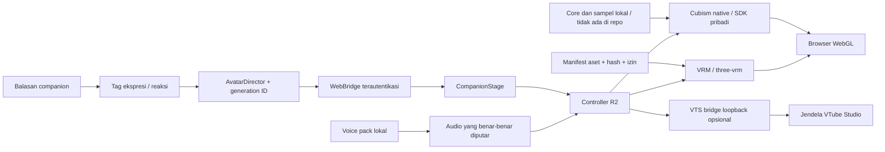

<p align="center"></p>

<p align="center"><b>Desktop · Web · Android interface · Modular voice · Agent tools · Avatar laboratory</b></p>

# Leva — Personal AI Assistant

Asisten AI pribadi untuk Windows yang menghubungkan percakapan, suara, pengetahuan dan alat pekerjaan pada laptop. Desktop dan web memakai layanan pelaksana yang sama; HP menjadi antarmuka pribadi bagi laptop.

> **Source snapshot 0.44.0 · 26 Oktober 2026.** Checkpoint R04-A pemisahan artwork dan QA developer; rig premium belum selesai; 3D R2 dipertahankan. Model AI, aset karakter, SDK Live2D, voice pack, credential dan data pengguna tidak disertakan. Avatar premium final dan kendali universal seluruh aplikasi belum diklaim selesai.

<table><tr><td width="33%" valign="top"><h3>Percakapan</h3><p>Ruang Asisten, Chat, Secret ♡ dan Leva ♡ dengan konteks serta model sesuai tujuan. ASR, LLM dan TTS merupakan tahap terpisah.</p></td><td width="33%" valign="top"><h3>Pekerjaan</h3><p>Alat aplikasi/browser, terminal, patch, pencarian berkas, progres dan jurnal tugas. Hasil alat perlu diverifikasi; cakupannya tidak menjamin semua canvas atau game.</p></td><td width="33%" valign="top"><h3>Karakter</h3><p>Renderer VRM, controller reaksi/ekspresi, serta backend Live2D native dan VTube Studio opsional. Pemisahan renderer, state dan suara menjaga fleksibilitas.</p></td></tr></table>

## Perkembangan terbaru — 0.44.0 / checkpoint struktur R04-A

**R04 premium dan R05 full-body belum selesai.** Checkpoint ini memisahkan 12 layer yang terlihat dari sprite dasar menjadi OpenRaster/AOM editabel dan 57 ArtMesh, sambil mempertahankan 44 parameter serta 59 deformer R03. Tidak ada generative fill, upscaling atau klaim repaint premium.

- **Layer nyata:** tangan mekanik, lengan, rambut/pita, wajah, leher dan kerah; torso remainder masih diberi label menyatu. Permukaan tertutup dan tangan kiri yang terpotong belum digambar.
- **Panel developer terpisah:** slider dari skema parameter aktual, filter, override/reset, pilihan ArtMesh dan wireframe. Kanal yang tidak ada tidak ditampilkan seolah sudah berfungsi. Audio aktif tetap memiliki prioritas atas mouth override.
- **Preservasi dan round-trip:** 54 kombinasi pose lulus, geometri wajah yang tidak diubah identik dengan R03, komposisi layer raster sama dengan sumber, serta MOC3 identik setelah simpan/buka ulang/ekspor AOM.
- **Verifikasi:** 622 tes Python (satu skip opsional), 19 skrip JS, 104 pemeriksaan paket; 60,02 FPS rata-rata pada window 240 frame, p95/p99 18,30 ms, GPU aktual RTX 5070. Belum klaim 120 FPS terkunci.
- **Yang masih perlu artwork:** perspektif pipi/rahang/hidung, shoulder/underarm, bentuk tangan untuk wave/chin-contact, dan kaki/sepatu. Empat gesture lengan serta full-body belum diimplementasikan. Source art, SDK dan rekaman privat tidak disertakan.

[Laporan status](docs/avatar/live2d-r04/README.md) · [Layer](docs/avatar/live2d-r04/LEVA_LIVE2D_R04_LAYER_SEPARATION.md) · [QA](docs/avatar/live2d-r04/LEVA_LIVE2D_R04_VISUAL_QA.md) · [Graf modul](docs/avatar/live2d-r04/MODULE_MAP.md)

## Riwayat 0.43.0 — Rig Live2D lanjutan

Fork R03 menambah **44 parameter, 59 deformer dan 46 mesh**. Kepala X/Y memakai parallax terbatas, badan memiliki sway/lean dan napas, serta empat kelompok solver menggerakkan poni, rambut belakang/samping dan jaket. **Mata kiri rekonstruksi opsional** berasal dari mata kanan yang ada; pose wink asli tetap bawaan. Tidak menggunakan image generation.

- Uji nyata Core: **54 pose**, semua kontrol bergerak, posisi netral tetap dalam 8,94e-8 unit dari R02.
- Uji renderer 12 detik: **719 frame simulasi**; kedipan kedua mata, sumber ekspresi, gerak badan dan fisika terukur.
- Window 240 sampel: **60,02 FPS**, p95 18,30 ms, physics p95 0,10 ms pada 1076×583. GPU aktual RTX 5070; permintaan RTX 4050 masih dilaporkan tidak cocok.
- **622 tes Python**, satu skip engine gambar; **18 skrip JS**, **104 pemeriksaan paket**. Rekaman native disinkronkan setelah render untuk mencegah frame kosong.
- Batas: belum perspektif yaw, lengan independen atau cloth collision. AOM editabel dan MOC3 5.0 diuji; CMO3 tetap eksperimental. Aset, SDK dan rekaman privat tidak disertakan.

[Laporan](docs/avatar/live2d-r03/REPORT.md) · [Pemakaian](docs/avatar/live2d-r03/RUNBOOK.md) · [Graf modul](docs/avatar/live2d-r03/MODULE_MAP.md) · [Data validasi](docs/avatar/live2d-r03/verification-summary.json)

## Riwayat 0.42.0 — Leva Live2D editabel

Leva GFL2 SSR Live2D nyata sudah dirender melalui SDK lokal, disimpan dan dibuka kembali sebagai AOM editabel, lalu diekspor ulang ke MOC3 5.0. Fork privat menambah kemiringan kepala kecil dan fisika poni. **Ini rig awal, belum avatar premium lengkap sekelas AAA.** Tidak memakai image generation; atlas dan model sumber tetap utuh.

- **32 → 34 parameter, 52 → 54 deformer**, 35 mesh. Dua kontrol tambahan mempunyai keyform nyata, bukan rotasi kotak HTML.
- **12 ekspresi sumber**, framing dari batas mesh, lip-sync audio aktual, serta pilihan sumber dan rig turunan yang terpisah.
- **Perekaman opaque** menjaga RGB transparan tidak muncul sebagai garis pada video. Perbaikan ini tidak mengedit atlas.
- **622 regresi Python**, satu skip engine gambar; **17 skrip JS** dan **104 pemeriksaan executable**. Model, SDK, AOM dan media privat tidak disertakan di GitHub.
- **59,30 FPS** pada window akhir 240 sampel, frame p95 **18,3 ms** pada 1745×727; solver 60 Hz, physics p95 0,1 ms. GPU yang teramati **RTX 5070**. Hasil ini bukan klaim 60/120 FPS terkunci atau pembagian GPU sudah berhasil.
- **CMO3 masih gagal** pada validasi penulis Ayatsuri. AOM serta MOC3 sudah diuji; head yaw, seluruh fisika rambut/pakaian, Android fisik dan ASR barge-in otomatis belum disertifikasi pada kandidat ini.

[Laporan hasil dan batas](docs/avatar/live2d-r01/REPORT.md) · [Pemakaian / proyek editabel](docs/avatar/live2d-r01/RUNBOOK.md) · [Graf hubungan modul terbaru](docs/avatar/live2d-r01/MODULE_MAP.md) · [Data validasi](docs/avatar/live2d-r01/verification-summary.json)

## Riwayat 0.41.0 — R2 dan Live2D R0


- **120 FPS target** dengan frekuensi solver terpisah; Ultra memakai 60 Hz physics secara default. Fallback adaptif 120→60 tersedia, dengan uji overload sintetis.
- **24 profil ekspresi, sembilan reaksi** dan blending kanal yang tersedia. Angka itu bukan jumlah morph baru yang dibuat.
- **Fisika reversibel** pada aset yang boleh dimodifikasi: kategori rambut/pita/pakaian, collider mengikuti tulang, reset saat stall dan pose berubah besar.
- **Audio aktual menggerakkan mulut**, dengan silence/interrupt gate dan variasi berbasis fitur audio; belum phoneme alignment.
- **Live2D native nyata** memakai SDK lokal pengguna: model3, moc3, texture, physics dan pose. Bukti historis 0.41.0 menggunakan Hiyori resmi, bukan karakter Leva.
- **Bridge VTube Studio** sudah diuji autentikasi dan streaming lokal. Backend eksternal menampilkan model di jendela VTS; tidak menyajikan video avatar ke HP. API dimatikan kembali setelah uji.

3D tetap jalur utama, sementara 2D R0 kini aktif. Ilustrasi konsep Leva belum menjadi artwork berlapis atau rig Cubism. AAA dan model contoh tidak diganti namanya menjadi Leva.

| Validasi kandidat lokal | Hasil |
|---|---|
| Regresi pada source yang disanitasi | **620 tes**, 0 kegagalan, 1 skip engine gambar |
| Skrip JavaScript | **16 lulus** |
| Pemeriksaan frozen package lokal | **104 lulus** |
| Leva VRM Ultra | Sekitar 120 FPS rata-rata window pendek; p95 sekitar 11,2 ms |
| Native Live2D Ultra | 118,35 FPS rata-rata; p95 11,4 ms; solver 60 Hz |
| Native lip-sync | Bukaan mulut 0,585 ketika bicara dan 0 setelah dihentikan |
| GPU renderer yang terbukti | RTX 5070; permintaan RTX 4050 belum cocok |

120 FPS belum terkunci: p95 tersebut melebihi interval 8,33 ms. Window pendek, profil UV dan aplikasi latar pengguna dipertahankan; hasil ini bukan benchmark terkontrol lintas perangkat. Uji Android fisik dan gaming serentak belum selesai. [Ringkasan terstruktur](docs/avatar/r2/verification-summary.json) · [Performa dan batas](docs/avatar/r2/PERFORMANCE.md).

## Arsitektur avatar



State dan audio dibagi; renderer serta asetnya tetap terpisah. Preferensi GPU adalah permintaan yang diverifikasi lewat renderer aktual. Peta Graphify seluruh proyek di [docs/architecture](docs/architecture) masih arsip 0.28.0; diagram di atas merangkum avatar R2; tambahan Live2D 0.42.0 ada di [peta modul terbaru](docs/avatar/live2d-r01/MODULE_MAP.md).

## Bukti visual historis


[Rekaman transisi R1 tanpa audio](docs/avatar/r1/media/r1-facial-transitions.mp4). Media ini berlabel historis 0.40.0; rekaman R2, sampel SDK, suara dan screenshot pribadi disimpan lokal.

## Menjalankan source

Source menargetkan Windows. Sesuaikan lokasi DATA, registry model dan adapter yang dipakai. Repository tidak menyediakan model, folder percakapan, token, SDK Core atau karakter.

```powershell
python -m pip install -r requirements-preview.txt
python experiments/run_isolated_regressions.py ./local-data/verification
node experiments/test_avatar_reactions.mjs
node experiments/test_avatar_timing.mjs
node experiments/test_live2d_native.mjs
```

Pengujian mengalihkan DATA sebelum import aplikasi. STT/TTS/LLM mempunyai environment tambahan. Untuk konfigurasi lokal yang lengkap, entrypoint `python app/main.py`; tinjau pilihan audio/startup terlebih dahulu. Cubism diunduh pengguna secara terpisah dari [Live2D](https://www.live2d.com/en/sdk/download/web/). Script persiapan lokal tidak membundel vendor Core ke GitHub.

## Dokumentasi

- [Laporan kandidat R2 + Live2D R0](docs/avatar/r2/LEVA_PREMIUM_AVATAR_R2_REPORT.md)
- [Fisika dan batas aset](docs/avatar/r2/PHYSICS.md)
- [Reaksi, ekspresi dan audio](docs/avatar/r2/REACTIONS_AUDIO.md)
- [Grafik, supersampling dan status ray tracing](docs/avatar/r2/GRAPHICS.md)
- [Native Live2D dan bridge VTS](docs/avatar/r2/LIVE2D_R0.md)
- [Matriks penerimaan](docs/avatar/r2/ACCEPTANCE.csv)
- [Source snapshot dan pengecualian](SOURCE_SNAPSHOT.json)

**Masih terbuka:** penyempurnaan layered art Leva 2D dan CMO3, head yaw, seluruh rig rambut/pakaian, modifikasi rig/material/tekstur Leva yang diperbolehkan, penilaian clipping menyeluruh, ray tracing, phoneme alignment, pembagian GPU yang terbukti, Android fisik, stress test dan persetujuan visual pemilik proyek. Source VRM Leva yang membatasi modifikasi tetap dipertahankan; keberhasilan pada sampel berizin tidak menggantikan hasil karakter final.

Leva merupakan karakter Girls' Frontline 2; hak karakter dan aset tetap pada pencipta/pemegang hak terkait. Ini proyek asisten pribadi independen. Model asli dan kontribusi script/renderer adalah hal berbeda. Lisensi renderer yang dibundel ada di `app/leva_web/THIRD_PARTY_NOTICES.txt`; SDK dan sampel terpisah mengikuti lisensinya masing-masing.
