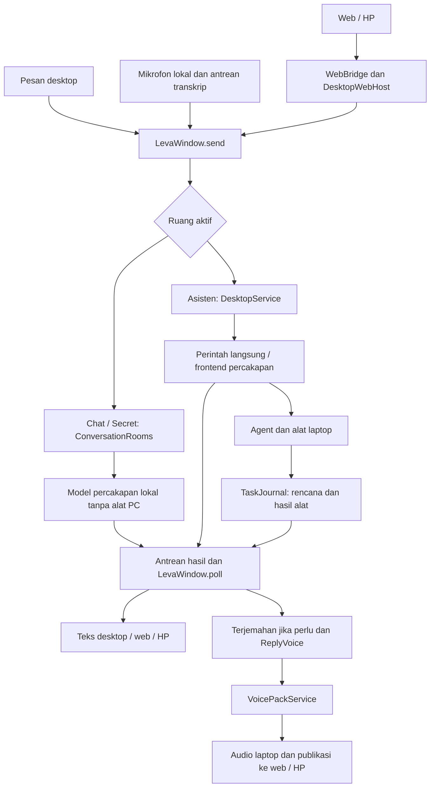

# Leva — peta arsitektur dan hubungan modul

Snapshot **23 Oktober 2026**, berdasarkan aplikasi pengembangan **0.28.0**. Pemetaan mencakup 167 berkas pada `app/`, dengan **2.356 node, 7.381 hubungan, dan 106 komunitas**.

> Source yang tersimpan di repository ini masih merupakan import historis **0.3.0**. Graf di folder ini mendokumentasikan snapshot pengembangan **0.28.0** yang dianalisis terpisah. Dokumentasi ini tidak menyatakan source 0.28.0 telah dipublikasikan atau seluruh fitur lulus uji langsung.

## Alur utama yang diperiksa

Diagram ini merupakan ringkasan alur hasil pemeriksaan sumber. Arah diagram dirancang dari pemanggilan kode; graf Graphify lengkap bersifat **tanpa arah**, sehingga jalur terpendeknya bukan urutan eksekusi.

## Berkas untuk dijelajahi

- [Laporan graf lengkap](graphify-out/GRAPH_REPORT.md)
- [Penelusuran LevaWindow beserta lokasi sumber](graphify-out/LEVAWINDOW_FLOW.md)
- [Graf interaktif HTML](graphify-out/graph.html) — unduh lalu buka di browser; GitHub menampilkan source HTML. Visualizer memakai vis-network 9.1.6 dari CDN unpkg dan memerlukan internet untuk memuat pustaka tersebut.
- [Graf JSON](graphify-out/graph.json), [audit integritas](graphify-out/graph-health.json), dan [provenance snapshot](graphify-out/SNAPSHOT.json)
- [Benchmark heuristik](graphify-out/benchmark.txt) — bukan pengukuran biaya atau ketepatan jawaban nyata.

## Hal yang sudah terlihat pada kode

- Desktop, transkrip mikrofon, dan HP diteruskan ke dispatch utama yang sama.
- Chat dan Secret memiliki penyimpanan riwayat per ruang, pemilihan model, dan pembatasan alat PC. Chat dapat melakukan riset publik melalui jalur terbatas.
- Asisten memiliki delegasi ke agent, eksekusi alat host, serta jurnal untuk hasil dan kelanjutan tugas.
- Teks, penerjemahan Jepang, antrean sintesis, dan publikasi audio ke HP merupakan tahap terpisah.
- Snapshot status web membawa ruang aktif, progres tugas/suara, dan pengukuran perangkat keras.

## Batas bukti

Ekstraksi mentah mencatat 1.056 referensi endpoint belum terselesaikan, 13 self-loop, serta 189 penggabungan hubungan pada graf tanpa arah. Graf akhir memiliki nol endpoint tidak valid. Ini diagnostik graf, bukan bukti bug saat Leva berjalan. Hubungan INFERRED dan AMBIGUOUS perlu verifikasi.

`voice_packs.json`, dua CSS dan satu web manifest belum terwakili. Catatan rilis pada korpus masih historis sampai 0.13.2. Kelancaran duplex, ketepatan perpindahan model, penggunaan GPU, dan kendali penuh aplikasi tetap membutuhkan pengujian nyata.

Artefak publik hanya berasal dari daftar berkas turunan yang dipilih. Path mesin dan alamat jaringan pribadi disamarkan. Model, rekaman suara, database, credential, log ekstraksi, serta isi percakapan tidak disertakan.
