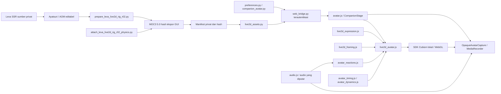

# Hubungan modul Live2D 0.42.0

Peta ini mengikuti source 0.42.0. Graf Graphify historis 0.28.0 tetap merupakan arsip terpisah.

`leva_ssr` dan `leva_rig_r02` mempunyai root serta manifest berbeda. Perekam mengambil canvas dan audio Leva saja; tidak merekam mikrofon, kamera, seluruh layar atau audio sistem. SDK dan artwork tidak dibundel di source publik.
