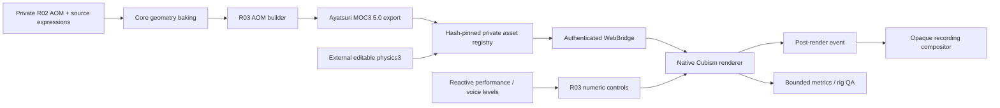

# R03 module relationships

`live2d_rig_controls.js` supplies limited head/body/breath motion and the opt-in eye. The provider applies source expression recipes first, overlays blink/gaze and audio mouth, applies R03 controls, then the fixed-step Cubism physics solver, and renders. A frame event captures native WebGL before its buffer may be discarded. On disposal the recording removes its event listener and tracks; source media and SDK remain external.
