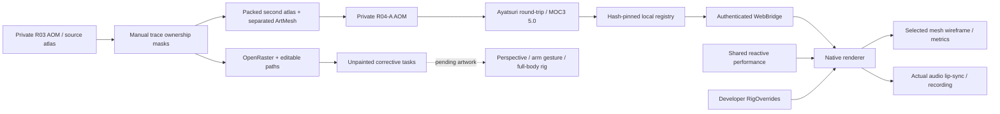

# R04-A module relationships

The second atlas contains cut source pixels, not newly painted hidden surfaces. The QA module receives a schema from Core, clamps only known IDs and does not create unsupported controls. Source switching re-applies chosen native settings. Original artwork, 3D and runtime selection remain preserved. No new avatar agent runtime was added.
