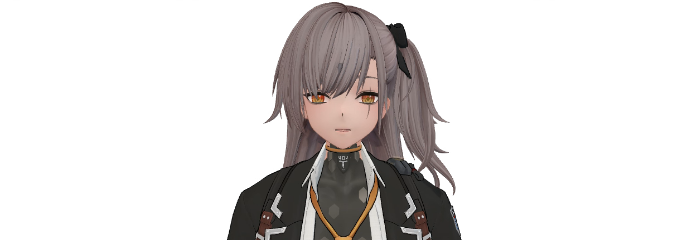

# Suara dan animasi — R1 / 0.40.0

Mulut ditahan saat hanya label backend speaking aktif tanpa playback. RMS dari buffer yang sedang diputar melewati noise gate dan attack/release smoothing; transisi kembali diam menutup mulut. Pose kepala, napas dan gaze mengikuti state/energi suara dengan amplitudo kecil.

Ini calibrated amplitude lip-sync pada kanal aa; bukan phoneme recognition atau viseme bahasa Jepang yang akurat. Tidak memakai timer untuk membuat suku kata. Demo memakai WAV Higgs Leva Jepang yang sudah ada; tidak menjalankan benchmark/model TTS berat atau mikrofon.

Video 12 detik memiliki audio Opus 48kHz stereo non-silent; rekaman MP4 merupakan transcode dari kanvas/audio yang sama. Tidak merekam audio sistem.

Demo Jepang bersuara tersimpan lokal; rekaman suara tidak diterbitkan dalam repository.

Kandidat R1 0.40.0; model Leva asli. Sumber tidak ditulis ulang. Penilaian visual pengguna masih PENDING. Bukti di `verification/leva-premium-avatar-r1` pada penyimpanan lokal; ringkasan yang aman dipublikasikan ada di verification-summary.json.
