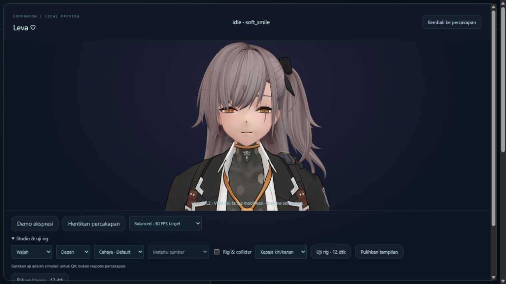
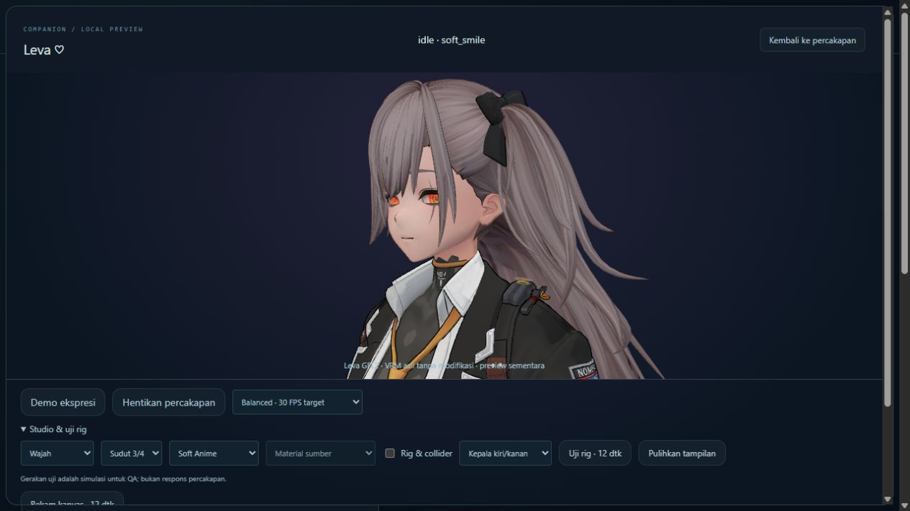

# Perbandingan visual — R1 / 0.40.0

Dua jenis perbandingan dibedakan: (1) baseline-controller versus R1 dengan framing/pose freeze/Default lighting/happy yang sama; (2) preset scene berbeda, yang memang mengubah cahaya. Tidak mengatribusikan perbedaan lighting pada texture enhancement.

Full-body Night, side profile dan rekaman pergerakan disimpan pada bukti lokal. Screenshot berasal dari renderer, bukan gambar generatif. User visual acceptance belum diberikan.

Kandidat R1 0.40.0; model Leva asli. Sumber tidak ditulis ulang. Penilaian visual pengguna masih PENDING. Bukti di `verification/leva-premium-avatar-r1` pada penyimpanan lokal; ringkasan yang aman dipublikasikan ada di verification-summary.json.
